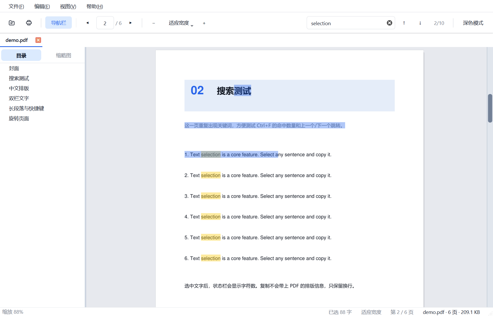
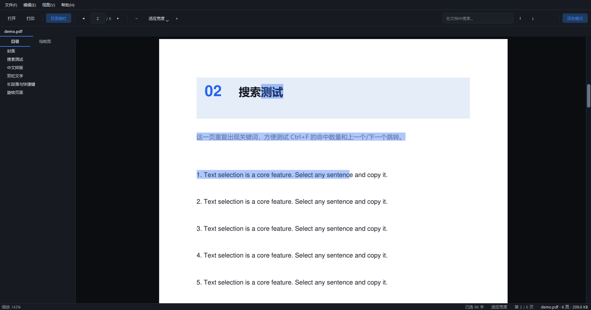
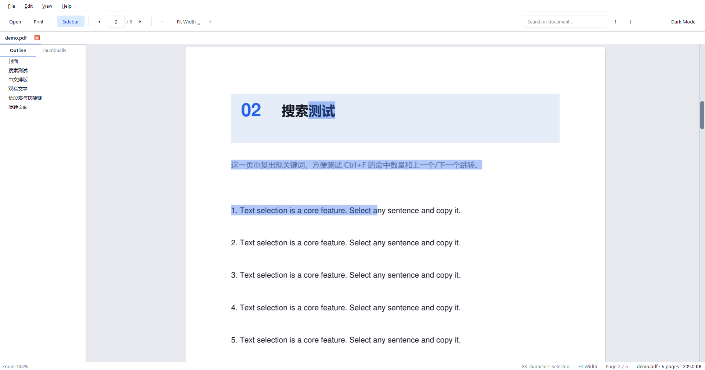

# pdfreader

一个面向 Windows 的轻量 PDF 阅读器：连续滚动、鼠标选中文字直接复制、全文搜索、目录和缩略图、多标签、深色模式、打印。单文件 exe，离线运行，不上传文件，不需要账号。



<details>
<summary>深色模式截图</summary>



</details>

<details>
<summary>English interface</summary>



</details>

## 功能

- 打开 PDF，连续滚动，支持多标签页
- **拖选文字 → Ctrl+C 复制**，按字符选择，可只选单词的一部分；保留换行，中文/英文混排不会乱加空格
- 双击选中整行；`Ctrl+A` 全选；选中后右键有“复制文字”菜单，也可复制本页 / 全文
- `Ctrl+F` 全文搜索，高亮全部命中，Enter / Shift+Enter 切换结果
- 导航栏（目录 / 缩略图两个标签页；缩略图分批生成，不卡界面，自动居中，宽度会记住）
- 缩放：适应宽度、适应页面、50%–400%、`Ctrl+滚轮` 以鼠标位置为中心缩放
- 深色界面；可选“反色页面”夜间阅读
- 打印（一页一张纸，自动缩放）
- 最近打开、启动页、拖放 PDF 到窗口
- 单实例：从资源管理器再打开一个 PDF，会在已有窗口里新建标签
- 完整的“打开方式”注册，以及对应的卸载清理
- 界面跟随 Windows 显示语言：中文系统显示中文，其他系统显示英文

## 快速开始

直接运行：

```powershell
.\pdfreader.exe "C:\path\to\file.pdf"
```

也可以双击 `pdfreader.exe`，在启动页选择文件，或把 PDF 拖进窗口。

### 文件关联（右键 → 打开方式）

有三种等价方式：

1. 程序里打开「文件 → 文件关联…」，点「注册 / 更新关联」。
2. 构建时带上参数：`powershell -ExecutionPolicy Bypass -File build.ps1 -Register`
3. 命令行：`.\pdfreader.exe --register`

注册只写 `HKEY_CURRENT_USER`，**不需要管理员权限**。完成后：

- 右键任意 `.pdf` →「打开方式」→ 选择 `pdfreader`
- 或者在「设置 → 应用 → 默认应用」里搜索 `pdfreader`，把 `.pdf` 交给它

> Windows 10/11 故意保护“默认应用”的最终选择（UserChoice 哈希），任何程序都无法静默把自己设为默认。pdfreader 会把自己注册成候选程序，最后一步需要你在系统设置里点一下确认。

### 卸载 / 移除注册表

“卸载”对绿色单文件程序来说就是删掉注册表里的关联：

- 程序内：「文件 → 移除文件关联…」
- 命令行：`.\pdfreader.exe --unregister`
- 脚本（可同时删除 exe）：

```powershell
# 只清注册表，保留 exe
powershell -ExecutionPolicy Bypass -File uninstall.ps1

# 清注册表并删除 pdfreader.exe
powershell -ExecutionPolicy Bypass -File uninstall.ps1 -RemoveFiles
```

脚本会处理 exe 已被删除的情况，直接按同样的路径清理。它不会动你的 PDF 文件。

注册表项（全部在 HKCU 下）：

```text
HKCU\Software\Classes\PDFReader.pdf
HKCU\Software\Classes\.pdf\OpenWithProgids        (值 PDFReader.pdf)
HKCU\Software\Classes\.pdf\OpenWithList           (值 pdfreader.exe)
HKCU\Software\Classes\Applications\pdfreader.exe
HKCU\Software\PDFReader\Capabilities
HKCU\Software\RegisteredApplications               (值 pdfreader)
HKCU\Software\pdfreader                            (窗口位置、最近文件、主题)
```

`uninstall.ps1` 会清理以上全部内容；程序内的“移除文件关联”和 `--unregister` 只清理文件关联，保留最近文件、窗口位置和主题设置。

## 快捷键

| 快捷键 | 功能 |
| --- | --- |
| `Ctrl+O` | 打开 PDF |
| `Ctrl+P` | 打印 |
| `Ctrl+F` | 搜索；Enter / Shift+Enter 切换结果；Esc 退出 |
| `Ctrl+C` | 复制选中文字 |
| `Ctrl+A` | 全选（超过 60 页时只选当前页） |
| `Ctrl+0` | 适应宽度 |
| `Ctrl+1` | 实际大小 100% |
| `Ctrl+2` | 适应页面 |
| `Ctrl++` / `Ctrl+-` | 放大 / 缩小 |
| `Ctrl+滚轮` | 以鼠标位置为中心缩放 |
| `F4` | 显示 / 隐藏导航栏 |
| `F11` | 全屏 |
| `PageUp` / `PageDown` / 空格 | 翻页 / 滚动 |
| `Esc` | 清除选择 / 退出搜索 |

## 构建

需要 64 位 Windows 10/11、Python 3.10+（本机用 3.14 验证）。依赖只有 PySide6、PyMuPDF 和打包用的 PyInstaller：

```powershell
python -m pip install -r requirements.txt

# 生成示例 PDF、图标，然后打成单文件 exe，并复制到项目根目录
powershell -ExecutionPolicy Bypass -File build.ps1

# 想顺便注册关联
powershell -ExecutionPolicy Bypass -File build.ps1 -Register
```

产物是 `pdfreader.exe`（约 56 MB，one-file Qt 程序的正常体积）。首次启动会解压到临时目录，比多文件版本慢 1–3 秒。

开发时直接跑源码：

```powershell
python run_pdfreader.py sample\demo.pdf
```

自检（会自动生成 `sample\demo.pdf`，检查文字提取、选择、剪贴板、搜索、旋转页坐标、渲染，并更新截图）：

```powershell
python run_pdfreader.py --selftest selftest-report.json
```

打包后的 exe 也能自检：

```powershell
.\pdfreader.exe --selftest report.json
```

### 图标

图标是原创设计：透明背景 + 白色文档 + 折叠角 + 红色 `PDF` 色带，不使用蓝色底块，也不使用 Adobe 的红色“A”商标。

```powershell
powershell -ExecutionPolicy Bypass -File tools\make_icon.ps1
```

脚本用 System.Drawing 从矢量形状生成 16–256 px 的多尺寸 `.ico`，同时输出 `assets/pdfreader.png`。exe 图标、窗口图标、资源管理器图标共用同一份资源。

## 项目结构

```text
pdfreader/
  run_pdfreader.py          开发 / PyInstaller 入口
  pdfreader/
    app.py                  主窗口、启动页、标签页、文件关联对话框、单实例
    document.py             PyMuPDF 封装：页、字符、目录、搜索、密码
    view.py                 连续滚动视图、分块渲染、选中文字、查找高亮、缩放、链接
    sidebar.py              目录树 + 缩略图
    printing.py             打印
    assoc.py                HKCU 文件关联的注册 / 移除
    i18n.py                 跟随系统语言的界面翻译
    theme.py                亮色 / 深色 QSS
    selftest.py             内置自检
  tools/make_icon.ps1       生成多尺寸 ico
  tools/make_sample_pdf.py  生成测试用示例 PDF
  assets/pdfreader.ico      应用图标
  sample/demo.pdf           示例文档（也会打进 exe 供自检）
  pdfreader.spec            PyInstaller 配置
  version_info.txt          exe 版本信息
  build.ps1                 构建脚本
  uninstall.ps1             清理注册表 / 可选删除 exe
```

## 实现说明

- **渲染**：页面按约 512 px 的小块分块渲染。拖动滚动条时先显示低分辨率整页预览，停止移动约 60 ms 后再逐块补齐清晰内容并合成完整页位图；单块只有几毫秒，事件循环始终能处理滚动条。缓存当前页附近的页面，离屏页面自动释放，避免大文档吃内存。高倍缩放时限制渲染分辨率。
- **选字**：按字符命中（`page.get_text("rawdict")`），拖动时取起止字符之间的连续区间，因此可以只选单词的一部分，而不是整词/整行；按块/行拼成文本，中文、标点、英文空格分别处理。旋转页会用 `page.rotation_matrix` 把坐标映射到显示坐标。
- **搜索**：每页调用 `page.search_for`，用 0ms 的 `QTimer` 分块处理，每块最多 6 页，避免大文档卡住 UI；命中总数上限 3000。
- **缩略图**：同样是分块生成，每次最多 4 页；单列缩略图始终在侧栏中居中，侧栏宽度保存在 `QSettings` 中，下次启动继续使用。
- **界面语言**：启动时读取 Windows 的显示语言；中文系统使用中文，英语及其他所有语言使用英文，不做运行时切换。调试时可用环境变量 `PDFREADER_LANG=zh` 或 `PDFREADER_LANG=en` 强制指定。
- **单实例**：`QLocalServer` / `QLocalSocket`，第二个进程把文件路径发给已有窗口后退出。
- **文件关联**：只写 HKCU，注册 ProgID、`OpenWithProgids`、`Applications\<exe>` 和 `RegisteredApplications` 能力项，并调用 `SHChangeNotify` 通知资源管理器刷新。

## 已知限制

- 只支持 Windows；exe 没有代码签名，首次运行可能提示“未知发布者”。
- 扫描件没有文字层，不能选字/搜索；本版本不内置 OCR。
- 选字以 PDF 里的字符为最小单位；某些排版（多栏、表格）的复制顺序取决于 PDF 内部内容流。
- 不支持编辑 PDF、批注、表单、签名、加密保存。
- 超大文档（数千页）打开会先读取每页尺寸，可能有短暂等待；全选只选当前页。
- 文件关联的“默认应用”最后一步必须在 Windows 设置里确认，这是系统限制。

## 参考项目

做之前参考了这些开源项目，主要借鉴交互和功能取舍，代码为原创实现：

- [SumatraPDF](https://github.com/sumatrapdfreader/sumatrapdf) — Windows 单文件阅读器的经典参考：快捷键、连续滚动、“打开方式”体验。
- [pdfreader-by-sparsh](https://github.com/sparshsam/pdfreader-by-sparsh) — 同样是 Python + PySide6 + PyMuPDF，功能清单（搜索、多标签、最近文件、深色模式、文件关联安装器）很有参考价值。
- [Open-PDF-Studio](https://github.com/jasonulbright/Open-PDF-Studio) — Tauri + React 的现代 PDF 工作台，阅读视图、搜索面板和侧栏布局的灵感来源。
- [KillerPDF](https://github.com/SteveTheKiller/KillerPDF) — PDFium 阅读/编辑器，标签页、缩放模式和全文搜索的交互参考。
- [miro](https://github.com/vincent-uden/miro) — 基于 MuPDF 的原生阅读器，深色模式、标签页和文字复制的实现思路。
- [PyMuPDF 文档](https://pymupdf.readthedocs.io/) — 渲染、文字坐标、搜索、链接和打印 API 的权威说明。

## License

本项目代码使用 MIT，见 [LICENSE](LICENSE)。图标为原创作品；项目名称和界面中不包含 Adobe 商标或 Adobe 素材。

打包后的 exe 还包含第三方库：PySide6（LGPL-3.0）和 PyMuPDF（AGPL-3.0，或商业授权）。分发 exe 时请同时遵守这些库的许可证；如需闭源商业分发，请向 Artifex 获取 PyMuPDF 商业授权。
